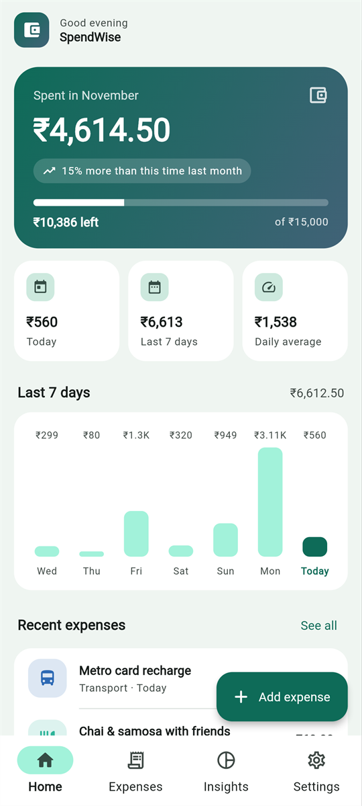
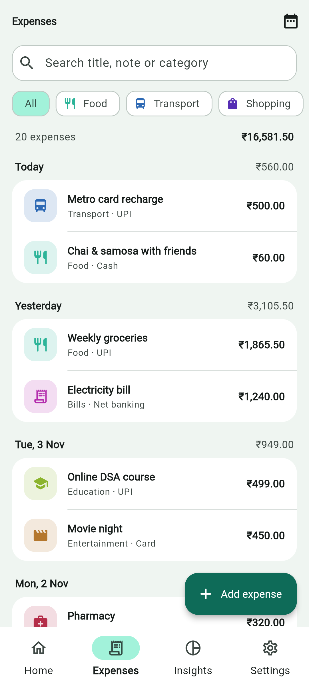
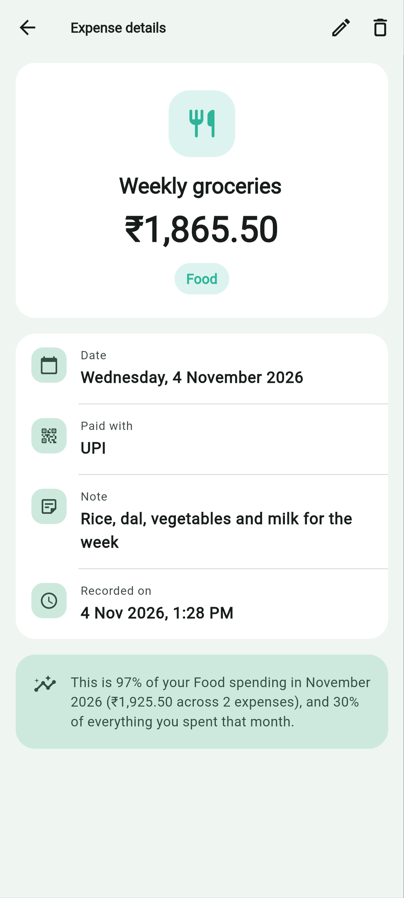
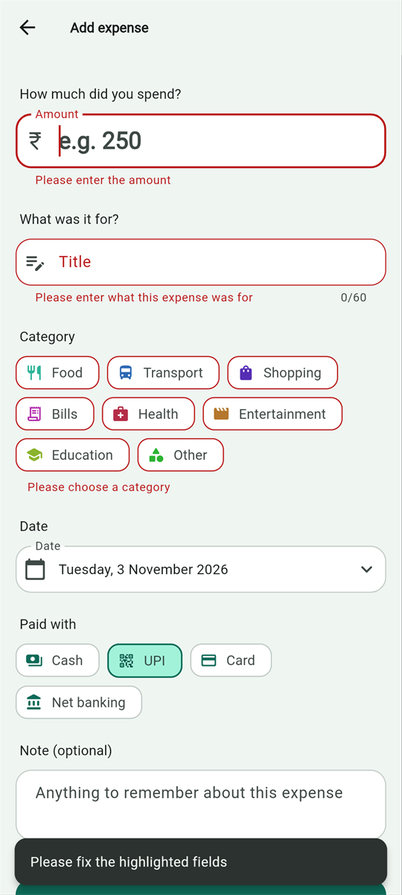
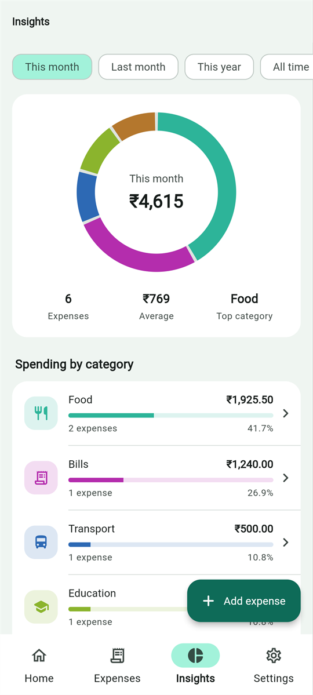
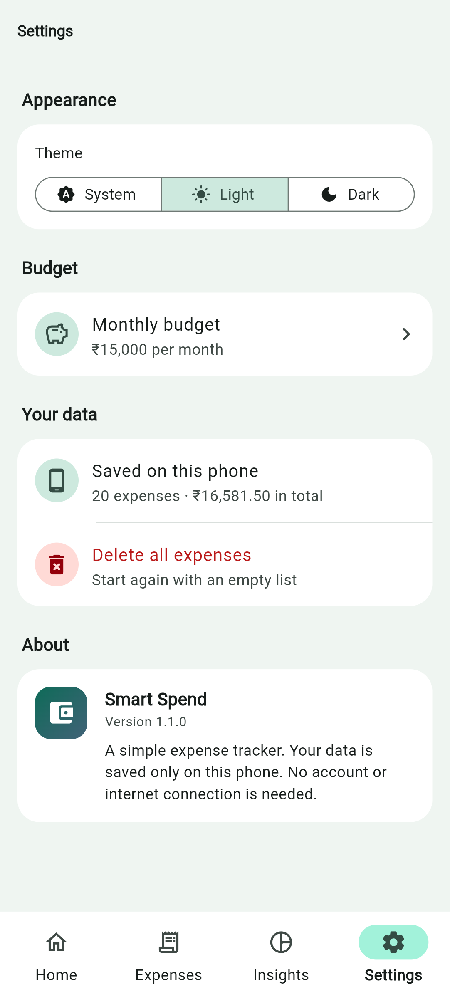
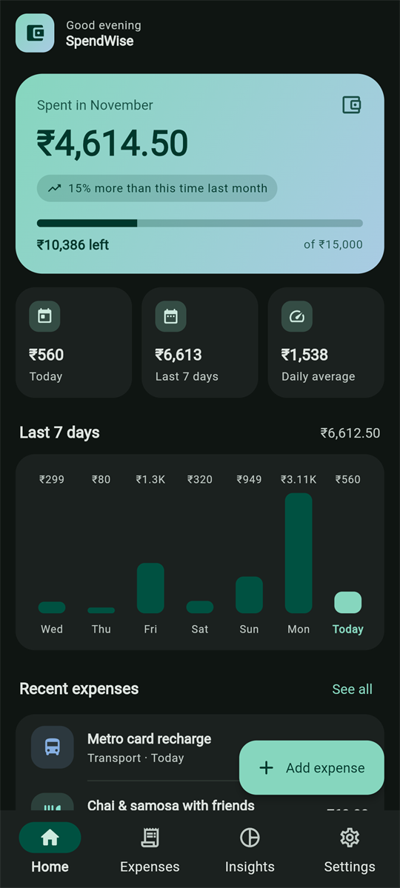
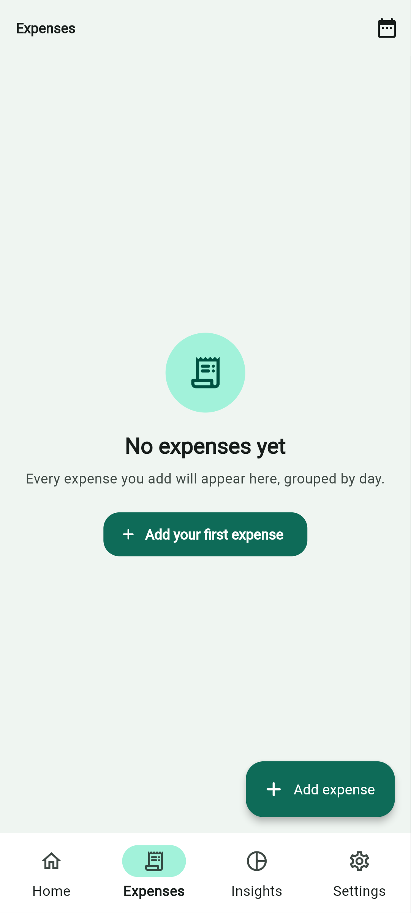

# SpendWise: Personal Expense Tracker

**Topic:** Expense tracker (Flutter Application Development Programme, group project)
**Platform:** Android · **Flutter** 3.35+ (stable) · **Dart** with null safety · **State:** Provider

SpendWise helps students and young earners see where their money goes. You record each
expense with an amount, category, date, payment method and note through a validated form.
The app groups your spending by day, compares this month with last month, tracks a monthly
budget, and shows a summary screen with totals per category. Everything is saved on the
phone, so it works offline and your data survives a restart.
## Table of contents
- [screenshorts](#screenshots)
- [Features](#features)
- [project Structure](#project-structure)
- [Team contributions](#team-contributions)
- [Rrequirements](#requirements)
## Screenshots

| Home | Expenses list | Expense detail | Form validation |
|:---:|:---:|:---:|:---:|
|  |  |  |  |

| Insights (summary) | Settings | Dark theme | Empty state |
|:---:|:---:|:---:|:---:|
|  |  |  |  |

## Features

- **Home dashboard:** this month's spending, change against the same days last month,
  budget progress, today / last 7 days / daily average, a 7-day bar chart and recent expenses.
- **Expenses list:** grouped by day with daily totals. You can search by title, note or
  category, filter by category chips and by period, pull to refresh, and swipe to delete with **Undo**.
- **Expense detail:** full date, payment method, note and recording time. It also shows
  what share of that month's category spending and total spending the expense makes up.
- **Add / edit form:** amount, title, category, date, payment method and note, with every
  field validated and a clear message for each mistake. A confirmation appears before
  discarding unsaved changes.
- **Insights (summary screen):** totals per category for this month, last month, this year or
  all time, shown as a ring chart and a ranked list. Tap a category to see its expenses.
- **Settings:** light / dark / system theme, monthly budget (validated dialog), delete all data.
- Works in portrait and landscape, ignores repeated fast taps, and needs no internet.

## Data source

All data is **created by the user and saved on the device** using
[`shared_preferences`](https://pub.dev/packages/shared_preferences). Expenses are stored as a
JSON list, and the theme and budget are stored as simple values. There is no external API and
no account, so no API key is needed. Data survives closing and reopening the app. Uninstalling the
app or clearing its storage removes it.

## How the requirements are met

| ID | Requirement | Where |
|---|---|---|
| GP1 | Four screens minimum | List `expense_list_screen.dart`, detail `expense_detail_screen.dart`, form `expense_form_screen.dart`, plus Home, Insights and Settings, all reachable by tapping |
| GP2 | Real data | User-created expenses saved with SharedPreferences (`services/expense_storage.dart`) |
| GP3 | Four screen states | `ExpenseListScreen`: `LoadingView`, `ErrorView` (with **Try again**), `EmptyView`, and the data list |
| GP4 | Validated form | `utils/validators.dart` checks amount, title, category, date and note before saving |
| GP5 | Detail view | Detail screen shows payment method, note, full date, recording time and spending share |
| GP6 | Shared state | `ExpenseProvider` and `SettingsProvider` (both `ChangeNotifier`) are read by every screen |
| GP7 | Theme | `theme/app_theme.dart` builds light and dark themes from **one seed colour**. Category colours are calculated from the same seed. Own app name and launcher icon |
| GP8 | Robustness | Input filter for amounts, length limits, fast-tap guard, scrollable layouts for landscape, rollback when saving fails |
| GP9 | Repository | This repository, with a README and [defect log](DEFECT_LOG.md) |
| GP10 | Release build | `flutter build apk --release` (see below) |
| GP11 | Test | 29 tests in `test/`, all passing with `flutter test` |

## Project structure

```text
lib/
  main.dart                 Starts the app and creates the Provider stores
  app.dart                  MaterialApp with light/dark themes
  models/                   Expense, ExpenseCategory, PaymentMethod, SummaryPeriod, CategoryTotal, LoadState
  services/                 ExpenseStorage, SettingsStorage (SharedPreferences)
  providers/                ExpenseProvider, SettingsProvider (ChangeNotifier)
  screens/                  HomeShell, Dashboard, ExpenseList, ExpenseDetail, ExpenseForm, Summary, Settings
  widgets/                  Reusable UI: tiles, charts, state views, form fields, dialogs
  theme/                    AppTheme (seed colour) and AppPalette (category colours)
  utils/                    Formatters, validators, amount input filter, layout, safe navigation
test/
  widget_test.dart          App-level widget tests (states, form, navigation, landscape)
  expense_provider_test.dart
  model_and_validators_test.dart
assets/icon/                Source images for the launcher icon
```

## Run the project

**You need:** Flutter 3.35 or newer (stable channel), Android Studio with the Flutter and Dart
plugins, JDK 17 (Android Studio's bundled JDK works), and an Android phone or emulator.

```bash
git clone <this repository URL>
cd SpendWise
flutter pub get
flutter run            # with a phone (USB debugging on) or an emulator connected
```

Check and test:

```bash
flutter analyze
flutter test
```

Build the release APK:

```bash
flutter build apk --release
# Output: build/app/outputs/flutter-apk/app-release.apk
```

The release APK is signed with the debug key, so you can install it directly on any Android
7.0+ phone. Allow "install unknown apps" for the app you open it with.

To regenerate the launcher icon after changing the images in `assets/icon/`, run
`dart run flutter_launcher_icons`.

## Team and contributions

| Member | Name | Parts owned |
|---|---|---|
| 1 | Mohammad Maqsood | Data layer: `models/`, `services/`, `providers/` (storage, Provider stores, totals and filters), `test/expense_provider_test.dart` |
| 2 | Mohammad Reesha Firdouse | Expense list, detail and form screens; form widgets and `utils/validators.dart`; `test/widget_test.dart` |
| 3 | M.Deepthi Sri Varma | Home dashboard, Insights screen and charts, Settings, theme and app icon |


## Other documents

- [Defect log](DEFECT_LOG.md): defects found during testing, steps to reproduce and status
- [Demo guide](docs/DEMO_GUIDE.md): the five-minute demonstration plan and a code walkthrough

## User Guide
This section explain how to use the SpendWise Expense Tracker application.
1. Open then SpendWise application to view the dashboard and your expense summary.
2. Select the Add Expense option to enter a new expense with its amount,category and details.
3. Open the Expenses and select to view your recorded expenses and select an expense to see its details.
4. Use the Insights screen to understand your spending patterns and expense breakdown.
5. Visit the settings screen to manage the available application preferences and theme.
6. Check your recorded expenses regularly to keep track of your spending.
7. All expense information is stored locally on the device.
Follow these steps to use the main features of SpendWise.

## Troubleshooting Guide

If you face any problems while using or running SpendWise, try the following solutions:

1. **Flutter command not found:** Make sure Flutter is installed and added to the system PATH.
2. **Packages not loading:** Run `flutter pub get` in the project terminal.
3. **App not running:** Check the Flutter setup and connected Android device or emulator.
4. **Build errors:** Run `flutter clean` followed by `flutter pub get`.
5. **Tests not running:** Use `flutter test` to check the project tests.
6. **APK not installing:** Make sure the device allows installation from the APK source and has a compatible Android version.

If the problem continues, check the error message in the terminal and resolve the issue before running the application again.
